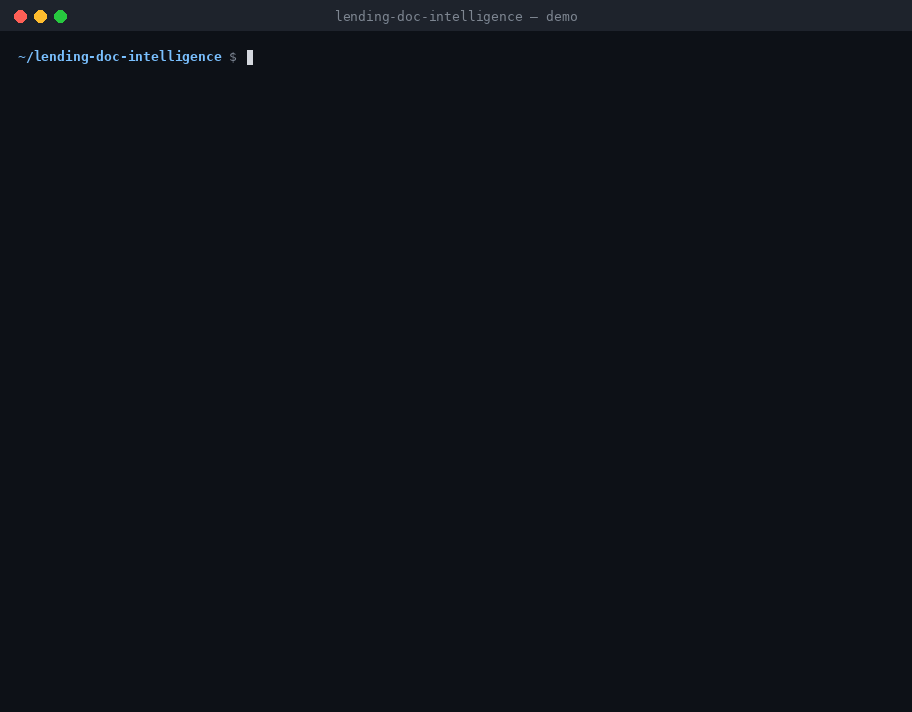
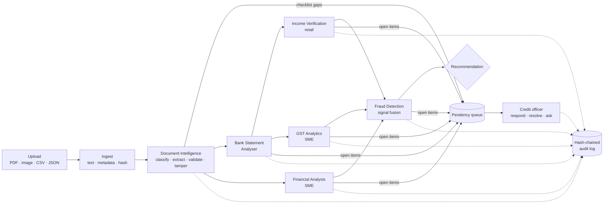

# Lending Document Intelligence

**Agentic document intelligence for loan origination.** Six agents digitize the document-heavy part of underwriting (KYC, bank statements, income, GST, financials, fraud) and turn every gap or discrepancy into a tracked query for the credit officer. Every step is written to a tamper-evident audit trail.

The system **recommends**; a credit officer **decides**.



```
$ python -m docintel.cli demo

 Rahul Sharma · RETAIL           → STP_ELIGIBLE             FOIR 37.2% · ABB ₹1.67L · fraud 0
 Karan Mehta · RETAIL            → REFER_FRAUD_REVIEW       edited statement · reused payslip · DOB/name mismatch
 Ganesh Auto Components · SME    → PROCEED_WITH_CONDITIONS  DSCR 1.42 · GST score 90 (A) · 48% anchor concentration
```

---

## Architecture



| Stage | What happens |
|---|---|
| **Upload** | Document Intelligence runs immediately. Classification, extraction and checklist update in real time. Uploading a missing document auto-resolves its open query. |
| **Process** | Agents run in dependency order. Bank runs before Income and GST so they can cross-check. Fraud runs last and fuses everyone's signals. |
| **Pendency** | Every `open_item` becomes a routed query (customer / credit officer / ops) with blocking flag and SLA. Queries no longer raised on re-run close themselves. |
| **Decision** | `STP_ELIGIBLE` · `PROCEED_WITH_CONDITIONS` · `PENDING_INFORMATION` · `REFER_TO_CREDIT` · `REFER_FRAUD_REVIEW` |

## The agents

| Agent | Does | Key outputs |
|---|---|---|
| **Document Intelligence** | Registry-driven classification (keywords + structure, Claude fallback below 60% confidence) · field extraction · checksum validation (PAN, Aadhaar Verhoeff, GSTIN, IFSC) · forensics (editing software in PDF/EXIF metadata, modified-after-creation, font inconsistency) · Aadhaar masked at extraction | doc type + confidence, fields, checklist status |
| **Bank Statement Analyser** | Layout-agnostic parser (CSV/AA rows or any text PDF: direction inferred from balance delta) · ABB on 5/10/15/20/25/EOM · 13-category tagging · EMI obligation + recurring-credit detection · bounce detection (EMI bounces escalated) · **running-balance continuity check** (catches edited statements) · window-dressing · penny-drop name match | ABB, monthly cash flow, bounces, EMI obligations, salary credits |
| **Financial Analysis** *(SME)* | 30 ratios: margins, ROE/ROCE, liquidity, leverage, DSCR, ICR, working-capital days, CCC, cash conversion · YoY + CAGR · sector benchmark bands · balance-sheet tally check | ratios by year, trends, benchmark breaches |
| **GST Analytics** *(SME)* | GSTR-1 vs 3B reconciliation by month · filing delays vs due dates · missing/nil returns · ITC utilisation (circular trading) · 0–100 compliance score with explained deductions · buyer concentration + sector risk map · **GST turnover vs bank credits** · GSTIN–PAN match | compliance score/band, variance, anchor risk |
| **Income Verification** *(Retail)* | Triangulates payslip, Form 16, bank salary credits, EPFO · verified income never exceeds cash actually received · employer-name consistency across sources · salary regularity · FOIR, max eligible EMI and loan | verified income, FOIR, max eligible loan |
| **Fraud Detection** | Duplicate documents across applications · PAN velocity · shared mobile/email/bank account across identities (rings) · name/DOB/PAN consistency · bureau soft pull · synthetic-ID heuristic · noisy-OR fusion of fraud-relevant signals only (weak credit ≠ fraud) | risk score + band, ranked reasons |

**Credit officer Q&A.** `orch.ask(app_id, "Why is the fraud risk high?")` routes the question to the right agent outputs and answers with cited evidence. With an API key, Claude writes the answer, restricted to that evidence.

## Quick start

```bash
git clone https://github.com/<you>/lending-doc-intelligence && cd lending-doc-intelligence
pip install -r requirements.txt

python -m docintel.cli demo                    # 3 sample cases end-to-end
pytest -q                                      # 24 tests
uvicorn docintel.api:app --reload              # API → http://localhost:8000/docs
```

Run on your own files:

```bash
python -m docintel.cli run --segment retail --name "Rahul Sharma" --pan ABCPS1234K \
  --amount 800000 --tenure 48 samples/retail_clean/*
```

Optional Claude layer (classification fallback, messy-layout extraction, PDF financials, officer Q&A):

```bash
export ANTHROPIC_API_KEY=sk-ant-...      # DOCINTEL_MODEL to override the model
```

Rules always run first. The LLM fills gaps and never overrides a validated field. Every LLM call is audited.

## API

| Method | Endpoint | |
|---|---|---|
| POST | `/applications` | Create (segment, product, applicant) |
| POST | `/applications/{id}/documents` | Upload files (multipart). Classified instantly |
| POST | `/applications/{id}/process` | Run the agent pipeline |
| GET | `/applications/{id}` | Full report: decision, agents, signals, pendency |
| GET | `/applications/{id}/results/{agent}` | One agent's full output |
| GET | `/applications/{id}/queries` | Pendency queue |
| POST | `/queries/{qid}/respond` · `/resolve` | Query lifecycle (resolve or waive) |
| POST | `/applications/{id}/ask` | Credit officer Q&A with evidence |
| GET | `/pendency/sla` | Open / blocking / SLA-breached by assignee |
| GET | `/applications/{id}/audit` · `/audit/verify` | Trail + chain integrity |

## Compliance by design

- **Aadhaar**: the full number is never stored. It is checksum-validated, masked to the last 4 digits, and only the vault reference is persisted (UIDAI ADV requirement).
- **Audit**: append-only, SHA-256 hash-chained. Editing any past entry breaks `verify()`. Records who, what, when and why for every agent run, LLM call, query and officer action.
- **Explainability**: every signal carries a code, severity, source agent, document id and evidence. No black-box score.
- **Human in the loop**: nothing auto-declines. Fraud and credit refer to people.

## Extending

- **New document type**: add one entry (keywords + field regexes) to [`docintel/doc_types.py`](docintel/doc_types.py). No code change needed.
- **Real integrations**: implement the protocols in [`docintel/connectors.py`](docintel/connectors.py) (PAN, penny drop, EPFO, bureau) and pass `Connectors(...)` to the orchestrator. The other integrations (e-sign, e-stamp, NACH mandate, account aggregator) fit the same pattern.
- **New agent**: subclass `BaseAgent`, implement `_run`, and add it to `PIPELINE`.
- **Policy**: FOIR cap, rates, variance tolerance and velocity window are in `Config`. Sector bands are in `BENCHMARKS` / `SECTOR_RISK`.

## Production gaps (honest list)

This is a working reference implementation, not a deployed product.

- Ships **~25 document types**. The registry scales to 100+, but each type needs real samples to tune.
- **Connectors are mocks.** Wire up vendor APIs (NSDL/Protean, DigiLocker, AA/FIU, EPFO, CIBIL/Experian/CRIF/Equifax).
- **OCR** uses Tesseract when installed. Production scanned docs and IDs need a stronger engine or Claude vision.
- **Image forensics** checks metadata only. Pixel-level tamper detection (ELA, copy-move) is a next step.
- **State is in-memory.** Back the orchestrator, pendency and identity registry with Postgres/Redis, and add authn/authz plus PII encryption at rest.
- **Benchmarks and thresholds are illustrative.** Calibrate them on your portfolio's performance data.

## Layout

```
docintel/
  agents/                 six agents + BaseAgent
  orchestrator.py         pipeline, recommendation, officer Q&A
  pendency.py             query lifecycle, auto-resolution, SLA
  audit.py                hash-chained audit log
  doc_types.py            document registry + required checklist
  validators.py           PAN / Aadhaar (Verhoeff) / GSTIN / IFSC
  ingest.py               PDF / image / CSV / JSON → Document
  connectors.py           external API protocols + mocks
  llm.py                  optional Claude layer
  api.py · cli.py
samples/                  synthetic test cases (python samples/generate.py)
docs/                     demo GIF + its generator (python docs/make_demo_gif.py)
tests/                    24 tests
```

All sample people, businesses and identifiers are fictitious.

MIT License.
